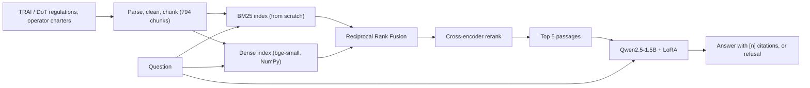

# TeleAssist

A retrieval-augmented question answering system for Indian telecom consumer rules. It answers from TRAI and DoT regulations and operator consumer charters, cites the passages it used, and is meant to say "I could not find this in the provided documents" when they do not contain the answer.

The retrieval stack (chunking, BM25, dense index, rank fusion) is implemented from scratch. The generator is Qwen2.5-1.5B-Instruct, fine-tuned with LoRA on synthetic question-answer data. Everything was evaluated on a small, manually verified question set, and the results below include what did not work.

## Architecture



## What is in the repository

- `src/teleassist/ingestion/` : download, PDF/HTML parsing with header/footer removal, token-aware chunking (512 tokens, 64 overlap).
- `src/teleassist/retrieval/` : BM25 (Okapi, from scratch), dense index, reciprocal rank fusion, cross-encoder reranker.
- `src/teleassist/generation/` : grounded prompt, LoRA-capable generator, citation parsing, refusal detection.
- `src/teleassist/training/` : synthetic training-data builder and LoRA training (TRL, answer-only loss).
- `src/teleassist/evaluation/` and `scripts/` : eval-set builder, review tools, leakage check, retrieval and generation evaluation.
- `src/teleassist/serving/` : FastAPI backend and Streamlit UI.

## Data

- **Corpus:** 18 official documents with usable text (TRAI regulations and amendments, the Telecommunications Act 2023, DoT KYC instructions, the TRAI consumer handbook, Airtel and Jio consumer charters, PIB press releases), giving 794 chunks. Draft and consultation papers were excluded. One operator charter (Vi) was a scanned PDF and was skipped. Wikipedia pages were part of the first corpus and were removed from the retrieval index after the first evaluation (see below).
- **Evaluation set:** 43 questions, every one manually reviewed (33 answerable, 10 unanswerable, 1 needs two passages). Questions were drafted by a hosted LLM (Gemini), about 100 drafts were reduced to 43 during review, and many kept questions were rewritten. Questions come from document families that are not used for training.
- **Training data:** 485 training and 106 validation examples built from official documents only, drafted by the same hosted LLM. v1 has 72 refusal examples. A near-duplicate filter removed training questions too similar to eval questions (maximum train/eval similarity after filtering: 0.69).

## Results

Everything below uses 33 answerable and 10 unanswerable questions. One question is about 3 percentage points, so small differences are noise. Retrieval numbers use the official-only index.

### Retrieval only (33 answerable questions)

| Mode | Hit@1 | Hit@5 | Hit@10 | MRR@10 | Right document in top 5 | Evidence text in top 5 |
|---|---|---|---|---|---|---|
| BM25 | 21% | 12/33 | 14/33 | 0.264 | 52% | 13/33 |
| Dense | 30% | 15/33 | 18/33 | 0.385 | 91% | 18/33 |
| Hybrid (RRF) | 24% | 15/33 | 18/33 | 0.313 | 82% | 17/33 |
| Hybrid + rerank | 27% | 16/33 | 19/33 | 0.376 | 82% | 17/33 |

"Hit" means a gold chunk is in the top k. The 95% interval on a hit@5 of 15/33 is about 30-62%. Findings: BM25 is the weakest. Dense search finds the right document about 91% of the time but the exact answer-bearing passage reaches the top 5 for only about half of the questions. Hybrid search and reranking showed no measurable gain over dense search, and the reranker added about 1.6 seconds per query.

### Six-system comparison (Colab T4, official-only index)

| System | Retrieval hit@5 | Cited the gold chunk | Refused unanswerable | Refused answerable | Mean latency |
|---|---|---|---|---|---|
| A. Base model, no retrieval | n/a | n/a | 0/10 | 0/33 | 3.2 s |
| B. Base + dense | 15/33 | 0/33 | 0/10 | 0/33 | 2.5 s |
| C. Base + BM25 | 12/33 | 0/33 | 0/10 | 0/33 | 2.6 s |
| D. Base + hybrid | 15/33 | 0/33 | 0/10 | 0/33 | 2.2 s |
| E. Base + hybrid + rerank | 16/33 | 0/33 | 0/10 | 0/33 | 6.3 s |
| F v1. LoRA + hybrid + rerank | 16/33 | 11/33 | 6/10 | 0/33 | 7.0 s |
| F v2. LoRA (refusal-targeted retraining) | 16/33 | 8/33 | 7/10 | 0/33 | 6.6 s |

The base model never writes citations, so its citation score is 0 by construction. Token-F1 and containment scores were flat (about 0.22-0.29 for every system, including the base model without documents), so they are not used to rank systems.

### What the fine-tuning did and did not do

- **It taught citation.** When the answer-bearing text was in the retrieved passages (17 questions), the v1 model cited a passage containing it in 12 of 17 cases.
- **It did not teach refusal when the evidence is missing.** When the evidence quote was not in the retrieved passages (16 questions), the v1 model answered all 16 and refused none.
- **v2** added 60 training examples where the supporting passage was removed and the answer was changed to the refusal sentence (132 of 485 examples were refusals). The result on the same 16 questions was still 0 refusals, and citation got worse (8 of 17). v1 is therefore the default adapter. This second round was designed after looking at v1's results on this eval set, so it should not be read as a clean held-out result.
- **A manual check of 8 random v1 answers** against their cited passages found 3 supported, 1 partly supported and 4 unsupported. The generator will sometimes cite a passage that does not contain its claim.
- **Sensitivity to the index:** with Wikipedia chunks in the index, v1 refused 2 of 10 unanswerable questions. With the official-only index it refused 6 of 10, with no retraining. Removing Wikipedia was chosen after the first evaluation showed generic Wikipedia pages outranking regulation text for plain-worded questions. It is a corpus decision, but it was made after seeing results on this eval set.

## Limitations

- 43 evaluation questions: wide confidence intervals, and differences of one or two questions mean nothing.
- Questions and training data were written by a hosted LLM, then reviewed (eval) or filtered by rules (training). Training data may contain errors.
- The evaluation covers porting, billing, complaints, KYC and operator terms. Spam/DND rules and quality-of-service rules are in the corpus but not in the evaluation set.
- Only 1 question needs two passages, so multi-passage reasoning is essentially untested.
- Train and eval use different documents, but the corpus restates some of the same rules in several places, so some factual overlap remains.
- The evidence-based metric needs the exact quoted text, so it understates retrieval when the same rule is worded differently elsewhere.
- LoRA was trained for one epoch on a free GPU; the answer-faithfulness problem was not fixed.
- Generated answers can be wrong or unsupported. This is a research prototype, not legal advice.
- Without a GPU, generation is very slow (one answer took about two minutes on a CPU laptop). The first request after starting the server also loads the models and is slow.

## Run it

```powershell
python -m venv .venv
.venv\Scripts\Activate.ps1
pip install -r requirements.txt
pip install fastapi uvicorn streamlit requests

# downloaded sources, indexes and adapter weights are not stored in git
.\tasks.ps1 data
.\tasks.ps1 build-index

python -m uvicorn teleassist.serving.api:app --port 8000
python -m streamlit run src\teleassist\serving\app.py
```

The API's default index is the official-only one (`chunks_official.jsonl`, the same chunks without Wikipedia pages). The LoRA adapter is expected at `models/teleassist-lora`; use `generate=false` or turn off the LoRA toggle to run without it.

Tests: `python -m pytest`.

